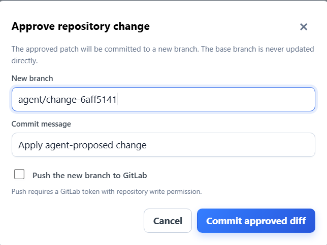

# Agent conversation verification

Run the complete suite from the repository root:

```powershell
dotnet test CSharp/Maf.HandoffWorkflow.slnx --no-restore
```

These tests execute real Microsoft Agent Framework workflows with scripted chat clients and local
tool stubs. They verify orchestration and conversation transport without paid provider requests.
They cannot prove every possible model response or the availability of external providers.

| Situation | Verification |
| --- | --- |
| Jira, Reviewer, and Security enabled or disabled | All eight configurations, with the expected active-agent sequence |
| Review and security findings | Each gate approves immediately or returns a blocker; security remediation re-enters Reviewer when enabled |
| Final release decision | Approval and rejection across the configuration and remediation matrix; Release Manager has no handoff tools |
| Handoff context | User instruction, prior evidence, and handoff summaries arrive at the next agent |
| Ordinary tools combined with handoffs | Planner, Developer, Reviewer, Security, and Jira consume tool results before choosing a handoff |
| Conflicting handoff destinations | Streaming and regular responses block all destinations and ask for exactly one; Reviewer and Security reconsider before ownership changes |
| Jira retrieval failure | Error evidence remains available to Jira, which reports unavailable context to Planner |
| Planner inspection loop | Three ordinary tool rounds, then the final plan is passed to Developer |
| Repeated review returns | Remediation budget stops further Developer provider calls (existing simulation and budget tests) |
| Repeated security returns | Global request budget stops the loop with and without Reviewer |
| Provider, read-tool, and cancellation failures | Required-stage provider errors cannot approve; tool errors can be inspected and recovered; cancellation reaches active providers at every required stage |
| Message and autonomous turn limits | Unfinished conversations stop without release approval |
| Hard execution limits | Direct factory workflows stop at the exact request boundary; per-agent limits include tool-only loops and repeated handoff activations |
| Checkpoint replay loops | Streaming and regular requests count replays toward execution limits while provider usage remains unchanged; a new run gets a fresh budget |
| Last permitted request | Release approval on the final allowed request succeeds without requiring an extra provider call |
| Premature or conflicting approval | Approval before tool evidence cannot override a later rejection; stops override conflicting approval; only assistant release output may approve |
| Streaming terminal markers | Whole markers and markers split into individual characters produce the same decision |
| Stop-marker text in user requests and tool results | Evidence containing marker literals does not prematurely stop tested handoff paths |
| User marker followed by ordinary assistant text | Termination checks ignore user marker literals even when the response has no handoff |

`MAF_MAX_AGENT_TURNS` counts each model request per agent across the entire run, including the initial
request, tool rounds, and checkpoint replays. `MAF_MAX_LLM_REQUESTS` bounds those requests across all
agents. Exhaustion returns an explicit stop status before another request; it never grants approval.
These are execution-count limits, not a token or dollar cap. An in-flight provider or tool call still
depends on its timeout/cancellation handling; count limits cannot interrupt a call that never returns.

The broader suite also covers repository boundaries, per-agent configuration, optional CodeGraph
fallbacks, tool-history filtering, checkpoints, and token accounting.

The Python implementation uses a separate Foundry workflow and is not validated by the C# suite.
Its tests must be run in a Python environment with the dependencies in `Python/pyproject.toml`.
