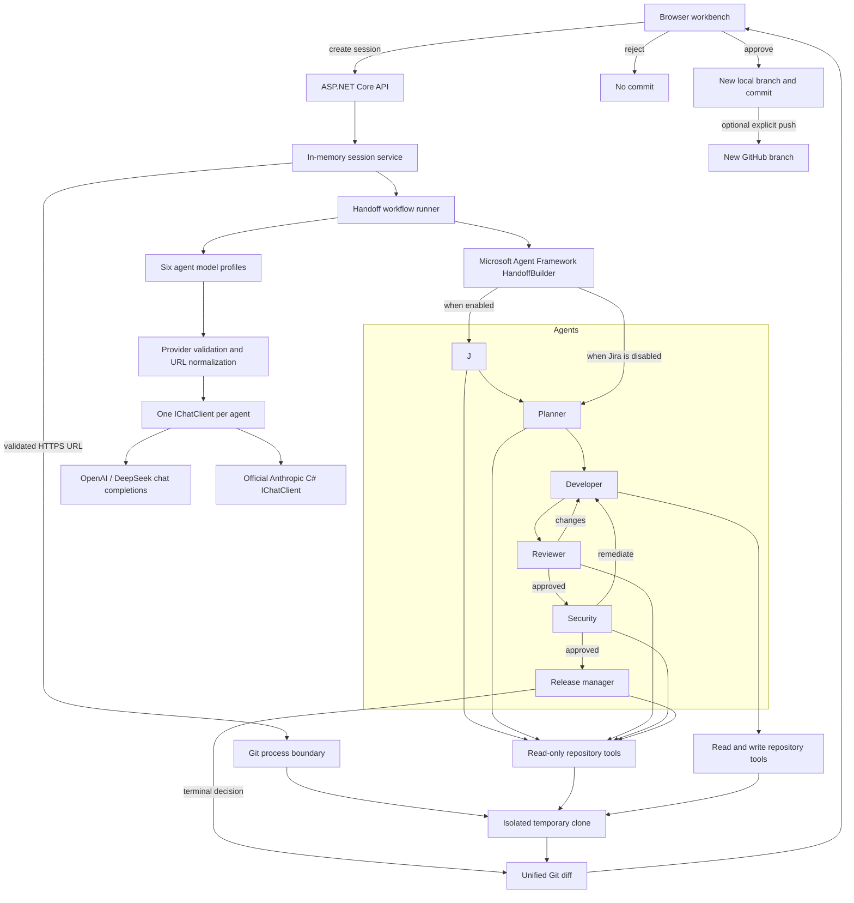

# Repository Change Architecture

## Lifecycle

1. The API validates the configured agent provider/model/reasoning profiles and creates an opaque session
   identifier.
2. Git validates the repository and branch and clones into a random directory under the configured
   temporary workspace.
3. When enabled, Jira assesses task readiness with full issue details, paginated comments, selected attachments,
   scoped read-only repository inspection, and reference-document search. It checks requirement clarity and
   consistency, code feasibility, dependencies, and integration risks before handing evidence to Planner.
   It can publish one consolidated Persian problem comment on the selected task. A durable `jira_problem`
   event records the actual posting outcome and drives the UI notice; repeated attempts reuse that outcome.
   Clarification pauses the active session at `awaiting_input`. The UI submits a question ID and answer to
   `POST /api/sessions/{id}/clarify`; the same agent resumes with that answer and the existing clone.
   The execution timeout pauses while waiting, and cancellation still stops the run. Marker-based
   assessments from custom prompts are intercepted before workflow termination; retries retain request budgets.
   Developer posts separate Persian scope-change comments on the bound task, with deduplicated outcomes
   and durable `jira_scope_change` events when the Jira agent is enabled. Disabled Jira runs receive no
   Jira tools or reporting clients and do not load Jira attachments.
   Planner, developer, reviewer, security, and release manager then use their scoped repository tools.
   Jira and Planner reads are compacted for reconnaissance. Developer reads preserve the source text,
   including whitespace and line endings, for exact edits. Text replacements require a unique match,
   treating only LF/CRLF/CR line endings as equivalent; they preserve local line endings, UTF-8 BOM,
   and unrelated content. This avoids failed edits caused by copying normalized text into a CRLF file.
4. Agent events and the current state are exposed through session polling without returning secrets.
5. The UI renders the exact diff and pauses at `awaiting_approval`.
6. Reject leaves the clone uncommitted. Approve creates a new branch and commit; push requires a
   separate checkbox and a GitHub token.

## Trust boundaries

- Repository content, model output, and user instructions are untrusted.
- Prompt rules guide models but are not the security boundary; tool path and size checks are.
- Git is invoked with structured argument lists and without a shell.
- GitHub credentials are process-environment values and are never embedded in repository URLs.
- This local sample stores sessions and secrets in memory and has no authentication or durable store.
- Arbitrary repository command execution is deliberately unavailable because cloned code is untrusted.
- Provider definitions are untrusted input. HTTPS, URL shape, token metadata, tool calling, and
  reasoning-effort compatibility are validated before a repository session starts.
- Provider keys can be reused by profiles assigned to the same provider, but each agent receives a
  separately constructed client and its own chat options.
