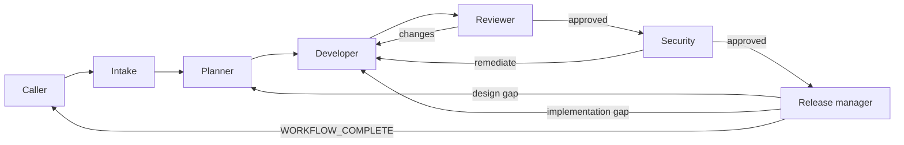

# Architecture

## Context

This service coordinates a software-delivery task across independent specialists. It uses handoff
semantics: the active agent transfers ownership, and the next agent receives the accumulated
conversation. The graph is deliberately constrained so model-selected routing cannot bypass the
review and security gates.

## Decisions

### Microsoft Agent Framework handoff orchestration

`HandoffBuilder` matches work whose ownership moves between specialists. It also injects only the
handoff tools allowed by the graph. This is preferable here to agent-as-tools, where one controller
retains ownership, or group chat, where gate ordering is harder to enforce.

### Fresh workflow per run

Each API call creates a new client, agent team, and workflow. Agent Framework workflows carry run
state; sharing a workflow instance across requests could mix conversations or introduce concurrency
hazards. Stable agent IDs and names allow a later checkpointed implementation to reconstruct the
same topology.

### Autonomous mode with two loop guards

Agents continue without pausing for a user response, but each agent has a turn ceiling and the full
conversation has a message ceiling. Only a release-manager message containing
`WORKFLOW_COMPLETE` represents successful completion; reaching a ceiling is a fail-safe stop, not
an approval.

### Advisory agents before action tools

This first version gives agents no filesystem, shell, browser, source-control, cloud, or deployment
tools. That makes the service useful for producing and reviewing implementation artifacts without
granting ambient authority. Add action tools only behind explicit schemas, workspace allowlists,
timeouts, output limits, audit logs, and human approval for consequential operations.

## Trust boundaries

- The task and all prior agent output are untrusted model input.
- Handoff edges constrain routing, but prompts are policy guidance rather than a security boundary.
- Azure identity is a privileged boundary. Local development uses `AzureCliCredential`; deployed
  workloads should use a narrowly scoped managed identity.
- The HTTP API has no authentication in this starter and must remain private until an identity and
  authorization layer is added.
- Model output must not be interpreted as executable code by downstream systems without validation
  and approval.

## Request lifecycle

1. `POST /runs` or `POST /runs/stream` validates the task size.
2. Runtime configuration selects Azure CLI or managed identity authentication.
3. A fresh Foundry client and handoff workflow are built.
4. Agent messages and handoff transitions are returned as normalized events.
5. The release manager emits the completion marker after review and security approvals.

## Next production increments

1. Add Entra ID authentication, tenant-aware authorization, request quotas, and cancellation.
2. Add durable checkpoint storage and a run repository so work survives process restarts.
3. Add OpenTelemetry export for agent calls, handoffs, latency, tokens, failures, and approvals.
4. Introduce repository tools in a sandbox with per-run worktrees and approval-required writes.
5. Use structured review/security result schemas and enforce their status in deterministic code.
6. Add evaluation datasets for routing accuracy, gate bypass, prompt injection, and loop behavior.

