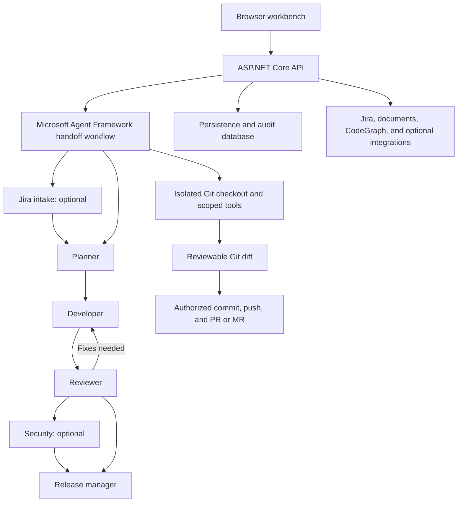

# Xbank.DevAgent

A browser-based workbench for AI-assisted repository changes, code review, and Jira task analysis, built with C#, .NET 10, and Microsoft Agent Framework.

Xbank.DevAgent coordinates specialized agents that inspect a repository, plan a change, implement it in an isolated checkout, and review the result. The workbench displays the resulting Git diff and supports committing, pushing, and opening a GitHub pull request or GitLab merge request with your authorization.

The application, solution, tests, and detailed documentation live under [`CSharp/`](CSharp/).

## Contents

- [Features](#features)
- [Architecture](#architecture)
- [Requirements](#requirements)
- [Quick start](#quick-start)
- [Configuration](#configuration)
- [Using the workbench](#using-the-workbench)
- [Optional integrations](#optional-integrations)
- [Command-line interface](#command-line-interface)
- [Development and testing](#development-and-testing)
- [Data and security](#data-and-security)
- [Troubleshooting](#troubleshooting)
- [Documentation](#documentation)
- [Contributing and licensing](#contributing-and-licensing)

## Features

| Area | Capabilities |
| --- | --- |
| Repository workflows | GitHub and GitLab repositories, isolated clones, branch selection, configurable autonomy, and separately authorized commit, push, and PR/MR creation. |
| Specialized agents | Jira intake, planning, development, review, optional security review, and release coordination, with independent model profiles. |
| Change review | Changed-file navigation, addition/deletion counts, inline and side-by-side diffs, run activity, and agent summaries. |
| GitLab MR review | Review an existing merge request against task requirements and apply review feedback. |
| Assistant chat | Tool activity, saved conversations, provider/model selection, document attachments, Jira mentions, and configured repository inspection. |
| Task Analysis | Explain or summarize Jira requirements in English or Persian, optionally using related codebases as evidence. |
| Jira planning | Read issues, epics, worklogs, boards, and sprints through configured tools. |
| Knowledge retrieval | Plain text document search, optional semantic search with Qdrant and embeddings, and optional Cognia organization knowledge. |
| Code intelligence | Bundled CodeGraph indexing and symbol/relationship queries, with checkout freshness verification. |
| Database inspection | Optional SQL Server schema, query, migration-history, and plan inspection through Alyio MCP MSSQL. |
| Administration | User accounts, coding rules, assigned AIFA keys, daily token allowances, and usage records. |
| Persistence | SQL Server by default, SQLite for embedded local use, and PostgreSQL with its runtime driver. |

Provider integrations include OpenAI, Anthropic, DeepSeek, and the organizational AIFA service. Provider profiles describe endpoint, model, tool support, context limits, reasoning effort, and optional pricing. Workflow models must support the tool calls required by their agents.

## Architecture



Jira and Security are optional workflow stages. Planner, Developer, Reviewer, and Release Manager form the core workflow. Review and security findings can return the change to Developer for remediation.

| Project directory | Responsibility |
| --- | --- |
| `CSharp/src/Xbank.DevAgent/Xbank.DevAgent.Api` | ASP.NET Core API, browser workbench, settings, and session management. |
| `CSharp/src/Xbank.DevAgent/Xbank.DevAgent.Core` | Agents, orchestration, provider clients, Git operations, and scoped tools. |
| `CSharp/src/Xbank.DevAgent/Xbank.DevAgent.Persistence` | Database providers and shared persistence support. |
| `CSharp/src/Xbank.DevAgent/Xbank.DevAgent.Cli` | Advisory command-line workflow. |
| `CSharp/src/Xbank.DevAgent/Xbank.DevAgent.Talk` | Optional Talk notifications. |
| `CSharp/src/Xbank.DevAgent/Xbank.DevAgent.CodeGraph.Console` | Workbench CodeGraph console integration. |
| `CSharp/src/Xbank.CodeGraph` | Bundled code indexer, contracts, and MCP server. |
| `CSharp/tests` | Application tests, CodeGraph tests, UI scripts, and quality checks. |

## Requirements

- **.NET 10 SDK.** `CSharp/global.json` requests SDK `10.0.101` with `latestFeature` roll-forward.
- **Git**, available on the API process's `PATH`.
- A modern browser.
- Access to NuGet package sources for restore. `CSharp/NuGet.Config` includes NuGet.org and the bundled Talk package feed.
- A supported AI provider and credentials to use AI features. Starting the workbench does not require making a model call.
- Repository credentials for private repositories and publishing changes.

Optional dependencies are Node.js for UI scripts, SQL Server for the default persistence configuration, and the services required by integrations you enable. The SQLite quick start requires no external database, Qdrant, or Ollama service.

## Quick start

Run these commands in **PowerShell**. Clone the repository, then enter the application directory so .NET uses the included SDK and NuGet configuration:

```powershell
git clone https://github.com/arash7388/Xbank.DevAgent.git
cd Xbank.DevAgent/CSharp
dotnet restore Xbank.DevAgent.slnx
dotnet build Xbank.DevAgent.slnx --no-restore
```

Choose SQLite for a standalone local installation. Clear the sample SQL Server connection string explicitly when switching providers:

```powershell
$env:Database__Provider = 'Sqlite'
$env:Database__ConnectionString = ''
$env:CodeGraph__Enabled = 'false'

dotnet run --project src/Xbank.DevAgent/Xbank.DevAgent.Api -- --urls http://127.0.0.1:8080
```

Open **http://127.0.0.1:8080** and sign in with the seeded local account:

| Username | Password |
| --- | --- |
| `admin` | `admin` |

Change this password in **Users** before sharing the installation. To seed a different initial administrator, set `Auth__Users__0__Username`, `Auth__Users__0__Password`, and `Auth__Users__0__Role=Admin` before the first startup. These values seed an empty users table; later account changes belong in the Users view.

The commands above disable CodeGraph until you are ready to index a repository. Environment variables apply to the current PowerShell session. The workbench's Settings view supplies repository and integration configuration; select provider credentials in the relevant AI controls.

## Configuration

The API's base configuration is in `CSharp/src/Xbank.DevAgent/Xbank.DevAgent.Api/appsettings.json`. Use environment variables or local .NET user secrets for credentials. Double underscores in environment variables represent configuration nesting.

| Setting | Purpose |
| --- | --- |
| `Database__Provider` | `SqlServer`, `Sqlite`, or `Postgres`. |
| `Database__ConnectionString` | Persistence connection string. Leave empty for separate default SQLite files. |
| `Database__EnsureCreated` | Create missing tables and indexes at startup; defaults to `true`. |
| `GitHub__Token` | Default GitHub repository credential. |
| `GitLab__Host` | Allowed GitLab host; defaults to `gitlab.com`. |
| `GitLab__Token` | Default GitLab repository credential. |
| `Jira__BaseUrl` | Jira server URL. |
| `Jira__AuthMode` | `Bearer` for PAT authentication, or Basic authentication. |
| `Jira__User` / `Jira__Password` | Credentials used with the configured Jira authentication mode. |
| `CodeGraph__Enabled` | Enable CodeGraph integration; defaults to `true`. |
| `CodeGraph__RootPath` | Override the bundled indexer source location. |
| `SqlServer__Enabled` | Enable agent database-inspection tools; defaults to `false`. |
| `Talk__Enabled` | Enable Talk notifications; defaults to `false`. |

For example, from `CSharp/`, save a local GitLab credential without editing tracked configuration:

```powershell
dotnet user-secrets set 'GitLab:Token' 'YOUR_TOKEN' --project src/Xbank.DevAgent/Xbank.DevAgent.Api
```

User secrets load in Development mode. Restart the API after changing server configuration. The Settings view stores its profile outside the repository and applies changes to new operations. Repository-specific GitLab credentials can override the shared token.

### Persistence

The shipped configuration uses SQL Server. Create the database and grant the application identity the necessary permissions before starting with this provider:

```powershell
$env:Database__Provider = 'SqlServer'
$env:Database__ConnectionString = 'Server=localhost;Database=XbankDevAgent;Integrated Security=True;Encrypt=True;TrustServerCertificate=True'
dotnet run --project src/Xbank.DevAgent/Xbank.DevAgent.Api
```

This connection string is a local development example. For a shared deployment, configure a trusted server certificate. The application creates tables and indexes when enabled; it does not create the SQL Server database or login.

PostgreSQL requires deploying the `Npgsql` runtime driver. Switching providers does not migrate existing data automatically. See [persistence setup, schema behavior, and account storage](CSharp/docs/persistence.md).

The `Database` section configures DevAgent's own storage. The separate `SqlServer` section configures optional database tools for agents; enabling one does not enable the other.

## Using the workbench

1. **Configure connections.** In Settings, register repository names and remote URLs, the appropriate source-control credentials, and optional Jira settings. For self-managed GitLab, configure the matching host.
2. **Choose a workflow.** Start a repository change or select an existing GitLab merge request for review. Choose the repository and base branch.
3. **Describe the task.** Supply expected behavior and acceptance criteria. Repository change branches require a clear task identifier, such as `BANK-123` or `task number 123`. Enable Jira when you want task intake and supporting attachments.
4. **Configure agents.** Select provider, model, reasoning effort, and credentials for each active agent. Choose autonomy and completion actions. Automatic commit, push, and PR/MR creation are separate authorizations.
5. **Run and follow progress.** Review agent activity, questions, findings, and summaries. Supply requested clarification or stop the run when needed.
6. **Inspect the diff.** Review the changed files and proposed patch. Approve the desired completion actions, or use the actions authorized before the run started.

GitHub publishing needs repository write access and pull-request write access for PR creation. GitLab publishing needs repository write access plus API permissions for MR creation. A public repository can be inspected without a source-control token when no publishing is requested.

**Chat** supports follow-up conversations, connected tools, and PDF, DOCX, or text attachments. Saved history can be reopened without rerunning past tool calls. Chat tools can edit configured local checkouts when requested, so those changes persist directly in that checkout.

**Task Analysis** reads Jira evidence and can inspect related codebases without starting a change workflow. English and Persian output are supported. It reports missing evidence and does not modify Jira or the inspected repository.

## Optional integrations

| Integration | Setup and behavior |
| --- | --- |
| Jira | Configure the connection in Settings. Provides task intake, selected attachments, issue/epic planning reads, and task-scoped workflow reporting. |
| CodeGraph | Enable it, then index the target C# codebase through **Admin → CodeGraph**. A stale or unverified index is excluded from a workflow. Access requires administrator privileges when authentication is enabled. |
| Reference documents | Plain text search works without external services. Semantic search additionally requires Qdrant and an embedding provider. |
| Cognia | Configure its endpoint, client credentials, and knowledge-base IDs in the connection step for read-only organization knowledge search. |
| SQL Server tools | Follow the [SQL Server integration guide](CSharp/docs/sql-server.md) to install and configure Alyio MCP MSSQL. Tools expose read-only inspection, not migration execution. |
| Talk | Follow the [Talk guide](CSharp/docs/talk-notifications.md) for optional workflow notifications. |
| AIFA | Uses the shared endpoint configured in application settings, with user-assigned or configured credentials. See the [application guide](CSharp/README.md#aifa-organizational-service). |

To start the included Qdrant service for semantic document search, run from `CSharp/`:

```powershell
docker compose -f docker-compose.qdrant.yml up -d
```

For local Ollama embeddings, install Ollama and download the configured default model:

```powershell
ollama pull embeddinggemma
```

Select semantic document search in the workbench after the services are available. OpenAI embeddings are another supported option. See the [reference-document guide](CSharp/README.md#reference-document-rag) for supported formats, limits, endpoints, and credentials.

## Command-line interface

The CLI runs an advisory handoff workflow. Use the browser workbench for repository checkout, diff review, and publishing.

From `CSharp/`, configure an accessible model endpoint and its credentials:

```powershell
$env:OPENAI_ENDPOINT = 'https://models.github.ai/inference'
$env:OPENAI_MODEL = 'openai/gpt-4.1'
$env:OPENAI_API_KEY = 'YOUR_MODEL_API_TOKEN'

dotnet run --project src/Xbank.DevAgent/Xbank.DevAgent.Cli -- 'Plan a change to add request validation and describe the tests needed.'
```

The model token authenticates the inference endpoint; it is separate from repository publishing credentials. Legacy `MAF_*` configuration names remain supported for compatibility.

## Development and testing

Run from `CSharp/`:

```powershell
dotnet restore Xbank.DevAgent.slnx
dotnet build Xbank.DevAgent.slnx --no-restore
dotnet test Xbank.DevAgent.slnx --no-build
node tests/ui/run-tests.cjs
```

The standalone UI scripts run with Node.js and do not require an npm install. They do not replace live browser testing.

For the repository's broader quality check, including Release build, C# tests with coverage, UI scripts, and CLI smoke tests:

```powershell
powershell -NoProfile -ExecutionPolicy Bypass -File tests/run-quality-checks.ps1
```

Reports are written under `CSharp/artifacts/quality-checks/`. SQL Server integration tests require a separately configured test server and permissions to create and drop test databases; see the [integration-test instructions](CSharp/docs/persistence.md#sql-server-integration-tests). Live-provider and external-service validation require their own credentials and services.

## Data and security

- **Repository workflows use isolated clones.** Their changes are shown as a diff before manual approval unless automatic completion was authorized upfront.
- **Agent tools are scoped.** Repository tools enforce path and size boundaries. Agents do not receive arbitrary shell, package-installation, or deployment commands.
- **Chat has a different editing scope.** Requested edits to a configured local checkout persist there, including alongside existing uncommitted work.
- **Credentials belong outside source control.** Use Settings, environment variables, or user secrets. Git credentials are not embedded in clone URLs. Settings use ASP.NET Core Data Protection; Windows key protection uses the current user's DPAPI.
- **Diagnostic data can contain sensitive content.** Checkpoints, chat history, tool results, and model responses can persist in the configured database. Protect database access and choose appropriate retention and backup policies.
- **Model calls transmit context.** Repository excerpts, selected Jira content, documents, and tool results may be sent to the selected provider. Use providers approved for the data you supply.
- **Protect the installation.** Replace the seeded password and configure HTTPS and access controls before exposing the API. Settings are shared under the OS identity running the service, rather than being isolated per browser user.
- **Back up encryption keys with stored data.** Encrypted credentials depend on the matching Data Protection key ring. Optional browser “Remember” controls also retain selected keys in browser local storage.

## Troubleshooting

| Symptom | Check |
| --- | --- |
| Startup cannot connect to a database | The default provider is SQL Server. Start and configure it, or use both SQLite overrides shown in the quick start. |
| A newly configured initial password does not work | Initial configuration only seeds an empty users table. Manage an existing account through Users. |
| Clone or branch loading fails | Verify the HTTPS remote URL, selected branch, repository token, network access, Git installation, and configured GitLab host. |
| A workflow cannot start with the selected model | Verify credentials, endpoint format, tool-calling support, and the provider's accepted reasoning settings. |
| CodeGraph warns about freshness | Reindex the correct branch/revision through the admin workbench, or disable CodeGraph for the run. |
| SQL Server tools fail to start | Install/configure their MCP dependency and test the connection, or disable SQL tool access. |
| AI requests return HTTP 429 | Check the account's daily token allowance and the provider's own rate or quota limits. Account allowances reset by UTC day. |
| A scanned PDF provides no useful text | Apply OCR or convert it to a supported text document before attaching it. |

## Documentation

- [Detailed application guide](CSharp/README.md)
- [Architecture and trust boundaries](CSharp/docs/architecture.md)
- [Database providers, persistence, and accounts](CSharp/docs/persistence.md)
- [SQL Server tools](CSharp/docs/sql-server.md)
- [Talk notifications](CSharp/docs/talk-notifications.md)
- [Agent conversation verification](CSharp/docs/agent-conversation-verification.md)
- [Testing assessment and scenario matrix](CSharp/docs/testing-assessment-2026-10-17.md)
- [Workflow reliability audit](CSharp/docs/workflow-reliability-audit-2026-10-17.md)
- [Performance audit](CSharp/docs/performance-audit.md)
- [Persian user guide](CSharp/docs/user-guide.fa.html) — download and open in a browser to view the rendered guide.

## Contributing and licensing

Keep changes focused on the C# application, follow the repository's agent instructions, and include the relevant build/test results with proposed changes. Describe the expected behavior and reproduction steps when reporting an issue. Remove credentials and private task or repository content from shared diagnostics.

No root project license file is currently included. Do not assume an open-source redistribution license; confirm terms with the maintainer. Bundled packages and dependencies retain their own licensing requirements, including the [Talk SDK notes](CSharp/vendor/talk/README.md).
